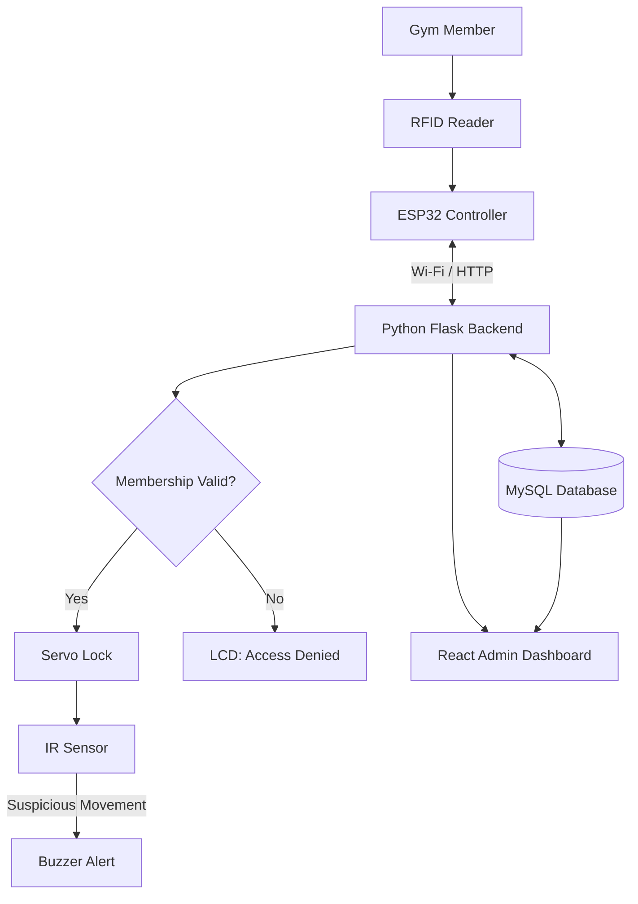

# 🔐 Gym Guard :- IoT-Based Smart Access Control System

<p align="center">
  <strong>Connecting Embedded Systems, IoT & Full-Stack Development</strong>
  <br><br>
  An intelligent access control solution that combines RFID authentication, real-time membership validation, sensor-based security, and a web-based admin dashboard to automate secure entry management.
  <br><br>
  
  
  
  
</p>

---

## 📌 Overview

Traditional access control systems often rely on manual membership verification or basic card readers that cannot validate whether a membership is still active. This creates opportunities for unauthorized entry, membership misuse, and poor access monitoring.

**This project connects physical access control with software-based verification.**

An ESP32 microcontroller communicates with a backend server to validate RFID credentials against a centralized database. Based on the result, the system controls a servo motor, monitors movement using an IR sensor, triggers security alerts, and records access activity for administrative monitoring.

The result is an integrated hardware-software system designed for gyms and other membership-based facilities.

## ✨ Key Features

| Feature | Description |
|---|---|
| 🪪 **RFID Authentication** | Identifies users through unique RFID card IDs. |
| 🔎 **Membership Validation** | Checks membership status and expiry information against MySQL records. |
| 🚪 **Automated Door Control** | Uses a servo motor to operate the locking mechanism after successful validation. |
| 👁️ **Anti-Tailgating Monitoring** | Uses an IR sensor to detect movement and potential multiple-person entry. |
| 🚨 **Security Alerts** | Activates a buzzer when unauthorized access or suspicious activity is detected. |
| 📟 **LCD Feedback** | Displays access decisions and relevant system messages. |
| 📊 **Access Logging** | Records successful and unsuccessful access attempts. |
| 🖥️ **Admin Dashboard** | Provides a web interface for monitoring activity and managing member information. |
| 🛡️ **Failure Handling** | Prevents access when authentication cannot be verified due to invalid credentials or communication failures. |

## 🏗️ System Architecture

The system integrates three layers: physical hardware, application logic, and centralized data management.



### 🔄 Authentication Workflow

<p align="center">
  <strong>IDENTIFY → VALIDATE → AUTHORIZE → MONITOR → RECORD</strong>
</p>

1. **Identify:** The RFID reader captures the member's card ID.
2. **Validate:** The ESP32 sends the ID to the Flask backend over Wi-Fi.
3. **Verify:** The backend checks membership information in MySQL.
4. **Authorize:** A valid membership activates the servo-based locking mechanism.
5. **Monitor:** The IR sensor monitors movement, and potential tailgating triggers an alert.
6. **Record:** Access attempts and their outcomes are stored in the database and made available through the admin dashboard.

### 🔐 Access Decision Logic

| Condition | System Response |
|---|---|
| Valid card and active membership | Grant access and activate the servo |
| Unregistered RFID card | Deny access and record the attempt |
| Expired membership | Deny access |
| Network or database unavailable | Keep access denied until verification succeeds |
| Potential tailgating | Trigger an alert and record the incident |

## 🧰 Technology Stack

### Embedded Systems & Hardware

<p>
  
  
  
  
</p>

- ESP32 microcontroller
- RFID reader and RFID cards
- IR sensor
- Servo motor
- LCD display
- Buzzer

### Software & Development

| Technology | Role |
|---|---|
| **Python** | Backend application logic |
| **Flask** | Backend API and request handling |
| **MySQL** | Member information, membership records, and access logs |
| **React** | Admin dashboard |
| **JavaScript** | Frontend interactions |
| **HTML & CSS** | Interface structure and styling |
| **Wi-Fi / HTTP** | Communication between the ESP32 and backend |

## 🗄️ Database Design

The database organizes member information and access activity using three principal tables.

| Table | Purpose |
|---|---|
| `RFID_Card` | Stores card identifiers and associated card information. |
| `Member` | Stores member details, card associations, and membership information. |
| `Log_Entry` | Stores access records, timestamps, and authentication outcomes. |

This structure connects card identification and membership validation with historical access records, supporting centralized monitoring and record retrieval.

## 🧠 Engineering Highlights

This project brings together multiple areas of computer science and embedded engineering.

- **Hardware-software integration:** Coordinating microcontroller inputs, sensor readings, physical actuation, and backend services.
- **IoT communication:** Exchanging authentication requests and responses between an ESP32 and a server.
- **Backend development:** Implementing server-side membership validation and access decision logic.
- **Relational database design:** Structuring member, RFID card, and access log information.
- **Event logging:** Maintaining records of successful and unsuccessful access attempts.
- **Fail-closed access control:** Rejecting access when membership validity cannot be confirmed.
- **System testing:** Evaluating individual components and the behaviour of the integrated system.

## 🧪 Testing & Validation

The project report documents **20 test cases** covering authentication, hardware operation, database connectivity, security scenarios, and failure handling.

| Test Category | Scenarios |
|---|---|
| Authentication | Valid cards, invalid cards, expired memberships |
| Hardware | Servo operation, automatic locking, LCD messages |
| Sensor monitoring | IR detection and multiple-person entry |
| Database & communication | Wi-Fi connectivity, log storage, database unavailability |
| Web application | Admin login, incorrect credentials, dashboard integration |
| Reliability | Repeated scans, network interruptions, power recovery |

### 📈 Reported Performance

The project report records an average response time of approximately **1–2 seconds** during the described performance test.

The listed test cases are reported as passing in the project documentation. These results reflect the reported testing and are not independent production benchmarks.

## 🛠️ Setup & Installation

> **Note:** The following instructions provide a general setup outline. Update the commands and configuration details to match the actual repository structure before publishing.

### Prerequisites

- Python and Flask
- MySQL Server
- Node.js and npm
- Arduino IDE or a compatible ESP32 development environment
- ESP32 board and the required hardware components

### 1. Clone the Repository

```bash
git clone <your-repository-url>
cd <repository-folder>
```

### 2. Configure the Database

Create the MySQL database and initialize the required tables using the SQL schema provided in the repository, if available.

### 3. Set Up the Backend

Configure the database connection and server settings. Install dependencies if a `requirements.txt` file is provided.

```bash
pip install -r requirements.txt
```

### 4. Set Up the Frontend

Navigate to the React application's directory containing `package.json`.

```bash
npm install
```

### 5. Configure the ESP32

Configure the Wi-Fi credentials, backend endpoint, and hardware pin assignments in the firmware. Upload the firmware to the ESP32 using the appropriate development environment.

### 6. Run the Application

Start the Flask backend and React frontend using the commands defined by their respective configurations.

Connect the hardware and scan a registered RFID card to verify the authentication result, servo response, LCD message, database entry, and dashboard update.

**Before publishing:** Replace the setup placeholders with the actual repository URL, startup commands, database initialization instructions, and hardware pin mappings.

## 🚀 Future Enhancements

- 🔒 Encrypted device-to-server communication and stronger authentication.
- 👁️ Enhanced anti-tailgating detection using multiple sensors or computer vision.
- 📱 Remote monitoring and security notifications for administrators.
- 📊 Attendance analytics and membership usage reports.
- 🌐 Support for multiple access points and facilities.
- 🧪 Expanded automated testing and performance evaluation.

## 🎯 Applications

- Gyms and fitness centres
- Membership-based clubs
- Restricted-access laboratories
- Educational and institutional facilities
- Other environments requiring automated access validation

## 👩‍💻 Project Information

| Detail | Information |
|---|---|
| **Project Title** | IoT-Based Access Control System |
| **Domain** | IoT, Embedded Systems, Backend Development |
| **Controller** | ESP32 |
| **Backend** | Python, Flask |
| **Database** | MySQL |
| **Frontend** | React, JavaScript, HTML, CSS |
| **Project Type** | Academic Major Project |

Developed at **Amrita Vishwa Vidyapeetham, Kochi Campus**, in collaboration with **Siffin Technologies Private Limited**.

---

<p align="center">
  <strong>Connecting the physical world with intelligent software.</strong>
  <br>
  <sub>Embedded hardware. Connected systems. Smarter access control.</sub>
</p>
